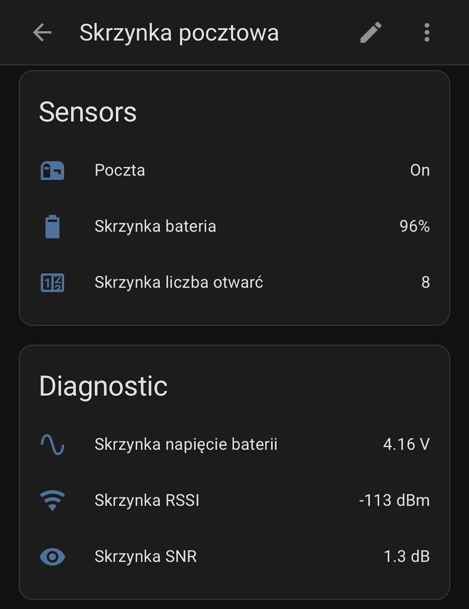
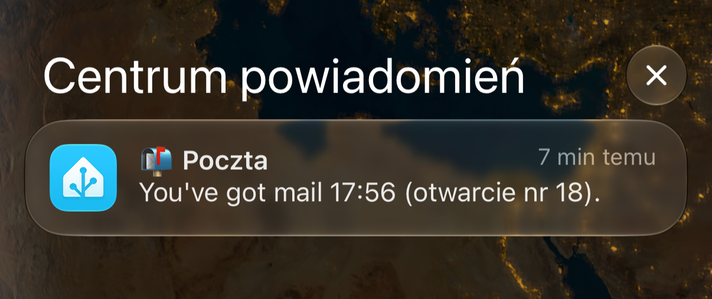
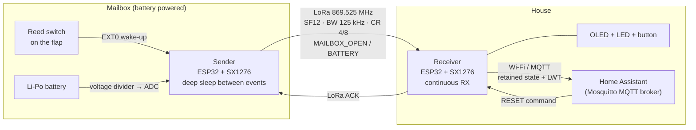

# mailbox-lora-sensor-pio

A LoRa mailbox notifier: a battery-powered sensor in the mailbox reports over a long-range,
low-power radio link when the flap is opened, and an indoor gateway turns those reports into
Home Assistant entities over MQTT.

It is built on two Heltec WiFi LoRa 32 V2 boards (ESP32 + Semtech SX1276) with PlatformIO, and
the protocol logic is covered by unit and integration tests that run on a computer in CI.

## Highlights

- **A difficult indoor link.** The sensor talks from inside a metal mailbox, around the corner
  of the building, with no line of sight.
- **Improved on three layers.** A custom antenna (+6 dB RSSI), SF12 with CR 4/8 (about 13 dB
  more sensitivity than SF7) and an application-level ACK/retry protocol.
- **Low power.** The sender sleeps in ESP32 deep sleep and wakes only on the reed switch or a
  daily heartbeat timer.
- **Tested without hardware.** Unit and integration tests run the sender and the receiver over
  a simulated lossy channel, in CI with AddressSanitizer and UBSan.

## Home Assistant

<table>
  <tr>
    <td align="center" valign="middle">
      
    </td>
    <td align="center" valign="middle">
      
    </td>
  </tr>
  <tr>
    <td align="center">Device entities: mail state, opening count, sender battery, and LoRa link
      quality (RSSI/SNR) as diagnostics</td>
    <td align="center">Push notification on the phone, sent by a Home Assistant automation when
      the flap opens</td>
  </tr>
</table>

## Overview

The **sender** is in the mailbox. It spends nearly all its time in ESP32 deep sleep. A reed
switch on the flap wakes it up, and it then:

1. measures the battery voltage while the radio is still idle,
2. sends a `MAILBOX_OPEN` packet over LoRa,
3. waits for an acknowledgement and retransmits if none comes,
4. goes back to sleep.

Once a day it also wakes up on a timer and sends a `BATTERY` heartbeat, so a dead battery or a
broken link shows up as a missing report instead of silence.

The **receiver** is indoors. It listens continuously, acknowledges every valid packet and
filters out retransmissions it has already counted. It shows the mailbox state on its OLED and
publishes it to Home Assistant over Wi-Fi/MQTT: mail present, number of openings, sender
battery, and the RSSI/SNR of the last packet. Mail is marked as collected either with the
board's button or with a `RESET` command from Home Assistant.

## Architecture



The protocol logic in `lib/mailbox_core` is plain C++ and reaches the hardware only through
small interfaces (`Radio`, `Clock`, `RandomSource`, `Logger`, `Mutex`). On the boards they are
backed by RadioLib and the Arduino core. In the tests they are backed by a simulated channel
that can drop or corrupt packets and inject foreign ones, so the full sender ↔ receiver
exchange runs on a computer.

## The radio link

The mailbox is only about 20 m from the flat, but around the corner of the building, inside a
vestibule, and made of metal (most likely aluminium), with the antenna enclosed in it. The
challenge is not distance but loss: diffraction around the corner, the vestibule walls, and a
metal box that both shields and detunes the antenna. Together they push 2.4 GHz Wi-Fi and BLE
past their link margin. LoRa at 868 MHz has about 9 dB less free-space path loss than 2.4 GHz,
and its chirp spread spectrum modulation decodes packets down to about −20 dB SNR, below the
noise floor.

| Parameter | Value |
|---|---|
| Frequency | 869.525 MHz (EU sub-band h1.4, 10 % duty cycle) |
| TX power | 20 dBm |
| Modulation | LoRa SF12, BW 125 kHz, CR 4/8, CRC on |
| Sensitivity / link budget | about −136 dBm / about 156 dB |
| Time on air | about 2.0 s per message, 1.2 s per ACK |
| Measured at the receiver | RSSI −113 dBm, SNR +1.3 dB: about **21–23 dB of link margin** |

The first version, with the stock antenna and default modem settings, was unreliable. Three
changes made the link dependable, each on a different layer:

1. **Antenna (physical layer).** A custom 868 MHz antenna placed for the inside of the metal
   mailbox raised RSSI by **6 dB** and SNR by **2 dB**, which is four times the received power
   at no cost in battery.
2. **Modulation (modem layer).** Moving to SF12 with coding rate 4/8 gains about **13 dB** of
   sensitivity over SF7 and doubles the forward error correction, at the cost of a 30× longer
   time on air. A sensor that sends a few packets a day can easily afford that.
3. **ACK and retries (link layer).** Sequence-numbered messages, acknowledgements, up to 3
   retransmissions with random back-off, duplicate suppression on the receiver, and a daily
   heartbeat that is retried hourly when it fails.

The whole exchange is tested in CI over a simulated channel that loses and corrupts packets.

## Documentation

- [docs/radio.md](docs/radio.md): why LoRa, the full link configuration, link budget, time on
  air and duty cycle, and how each improvement works.
- [docs/protocol.md](docs/protocol.md): packet format, the ACK/retry exchange with sequence
  diagrams, duplicate filtering, the sender's sleep and heartbeat schedule, and known
  limitations.

## Repository layout

- `src/sender`: firmware for the board in the mailbox (reed switch, battery measurement, deep
  sleep).
- `src/receiver`: firmware for the indoor board (OLED, button, LED, Wi-Fi and MQTT on core 0,
  LoRa on core 1).
- `lib/mailbox_core`: all the logic, free of Arduino dependencies. It contains the packet
  format, LoRa settings, battery curve, the sender (`MailboxSender`: retries, ACK wait,
  wake-up and sleep schedule) and the receiver (`MailboxReceiver`: ACKs, mail state). They
  reach the hardware only through the interfaces in `mailbox_hal.h`.
- `lib/mailbox_arduino`: those interfaces implemented with RadioLib and Arduino.
- `lib/heltec_v2`: the board's pin assignment.
- `test/native`: tests run on a computer. They cover unit tests of `lib/mailbox_core`, and
  integration tests (`test_integration_*`) where the sender and the receiver talk to each other
  through a simulated radio with a virtual clock (`test/native/support`).

## Setup

Copy `include/arduino_secrets.h.example` to `include/arduino_secrets.h` and fill in the Wi-Fi
and MQTT credentials. Only the receiver uses them.

## Build and upload

```
pio test -e native               # unit + integration tests (no board needed)
pio run                          # build both firmwares
pio run -e receiver -t upload    # flash the receiver
pio run -e sender -t upload      # flash the sender
pio device monitor
```

Always pass `-e` when uploading. Without it, PlatformIO flashes both firmwares to the same
board.
